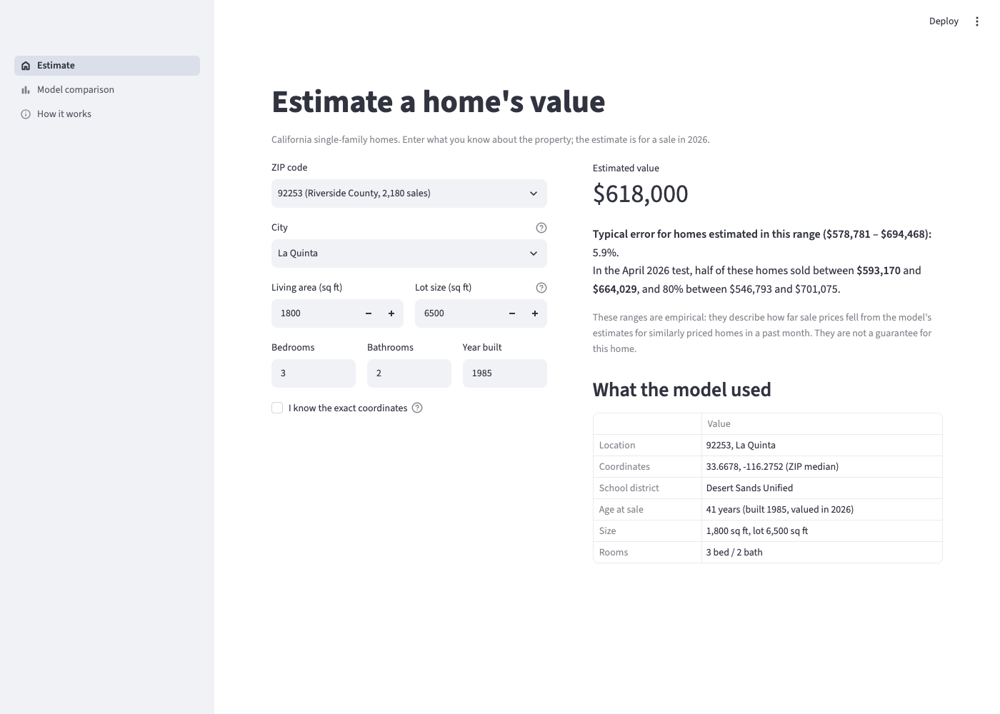
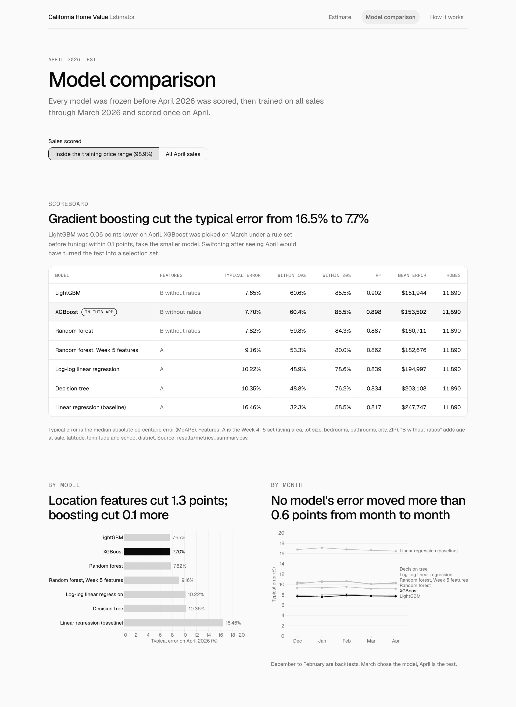
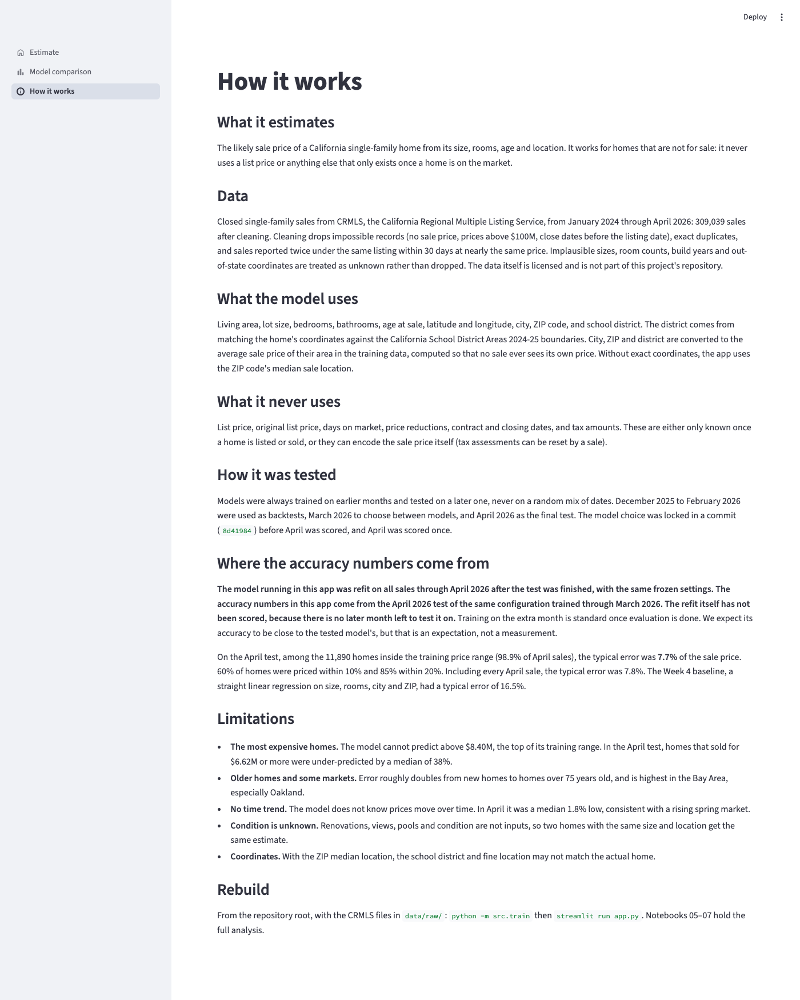

# IDX Exchange: California home price model (AVM)

An automated valuation model for California single-family homes. Given a home's size, rooms, age and location, it estimates the price it would sell for. It is built to work for homes that are not on the market, so it never uses a list price or anything else that only exists once a home is listed.

Built during the IDX Exchange data science internship (Weeks 1–10), on CRMLS sold-property data from January 2024 to April 2026.

**Final model:** XGBoost on ten inputs: living area, lot size, bedrooms, bathrooms, age at sale, latitude, longitude, city, ZIP code and school district. On April 2026, the held-out test month, it prices the typical home within **7.7%** of its sale price, against 16.5% for the Week 4 linear-regression baseline.

## Data and the trained model are not included

The CRMLS data is licensed through IDX Exchange and cannot be redistributed, so this repository contains **no raw or cleaned data and no trained model**. The same applies to anything derived from individual sales: per-sale predictions, the school-district lookup cache, and the app's model file and ZIP/error lookup tables. All of these are git-ignored and rebuilt locally from the raw files.

The repository does include code, notebooks with their outputs, aggregate metric tables in `results/`, the app's metadata, and a simplified copy of the public school-district boundaries.

## Quick start

1. **Set up Python 3.14.7** in a virtual environment and install the pinned packages:

   ```bash
   python -m venv .venv && source .venv/bin/activate
   pip install -r requirements.txt
   brew install libomp   # macOS only: LightGBM and XGBoost need the OpenMP runtime
   ```

2. **Get the CRMLS files.** IDX Exchange provides them over FTP. Ask IDX for access, then download the 28 monthly files from `raw/California` whose names start with `CRMLSSold`, January 2024 (`CRMLSSold202401_filled.csv`) through April 2026 (`CRMLSSold202604.csv`). Put them unchanged in `data/raw/`. Some months are named `..._filled.csv`; keep the names as they are.

   `scripts/crmls_sold.py` can instead pull a month from the Trestle API through IDX's token proxy. It reads the proxy key from `IDX_TOKEN_KEY`, either set in the environment or in a `.env` file (copy `.env.example`; `.env` is git-ignored). Ask IDX for the key.

3. **Get the school-district boundaries** (public, from data.ca.gov):

   ```bash
   mkdir -p data/external/school_districts_2024_25 && cd data/external/school_districts_2024_25
   curl -L -o school_districts_2024_25.zip \
     "https://gis.data.ca.gov/api/download/v1/items/b0e3b936426a47ce9d9a2e77e2bb86cc/shapefile?layers=0"
   unzip school_districts_2024_25.zip && cd -
   ```

4. **Build the model and the app files:**

   ```bash
   python -m src.train
   ```

   This cleans the data, joins school districts, refits the frozen final model on every month through April 2026, and writes everything the app needs to `models/app/`. It checks the data fingerprint first: with exactly the files above it is `66cab54017ab`. The run takes under a minute; the model file is 4.3 MB.

5. **Launch the app:**

   ```bash
   streamlit run app.py
   ```

## Other entry points

All are run from the repository root and work without the notebooks.

| Command | What it does |
|---|---|
| `python -m src.preprocess` | Cleans the raw files, joins school districts, prints rows removed per step, writes `data/processed/sales_clean.csv` |
| `python -m src.train` | Builds the deployed model and the app lookups in `models/app/` |
| `python -m src.evaluate [--month YYYYMM]` | Trains the final configuration on all months before `--month` and scores that month. With the default (April 2026) it reproduces the test and checks it against `results/metrics_summary.csv` |
| `python -m src.predict --zip 92253 --city "La Quinta" --living-area 1800 --lot-size 6500 --beds 3 --baths 2 --year-built 1985` | Estimates one home; `--csv homes.csv --out estimates.csv` does many (columns listed in `src/predict.py`) |

## The app

Three pages:

- **Estimate.** Enter a home and get an estimate, with a typical-error range taken from the April test for similarly priced homes. Warnings appear for unusual inputs, coordinates outside California, ZIPs with few sales, and estimates near the model's price ceiling.
- **Model comparison.** The April scoreboard and month-by-month error for every model.
- **How it works.** The data, the leakage rules, the evaluation and the limitations, in plain language.







The app's model is the frozen final configuration refit on all months through April 2026, after the April test was done. **Its accuracy figures come from the April test of the same configuration trained through March.** The refit has no later month to be scored on.

## Repository layout

```text
app.py                     Streamlit app
src/
  avm.py                   Loading, cleaning, features, models, splits, metrics (shared by everything)
  config.py                Paths and fixed reference values
  preprocess.py            python -m src.preprocess
  train.py                 python -m src.train
  evaluate.py              python -m src.evaluate
  predict.py               python -m src.predict (the app uses the same input preparation)
notebooks/
  01_exploration.ipynb         Week 2: distributions, missingness, price by city and month
  02_preprocessing.ipynb       Week 3: duplicates, target cleaning, first train/test split
  03_baseline_model.ipynb      Week 4: linear regression baseline and log-log variant
  04_model_comparison.ipynb    Week 5: decision tree and random forest
  05_feature_engineering.ipynb Week 6: engineered features, school districts, ablation
  06_advanced_models.ipynb     Week 7: LightGBM and XGBoost, tuning, final model choice
  07_evaluation.ipynb          Week 8: April 2026 test, error breakdowns, presentation summary
results/                   Aggregate metrics, tuning grids, bootstrap intervals, final config
models/app/                App metadata and boundaries (model and lookups are local only)
docs/screenshots/          App screenshots
scripts/crmls_sold.py      Optional download from the Trestle API
data/                      Local only: raw/, processed/, external/
```

## Method

### Cleaning

Only `PropertyType == "Residential"` and `PropertySubType == "SingleFamilyResidence"`. Rows are removed for:

- exact duplicates;
- a missing close date;
- a missing, zero or negative `ClosePrice`, or one above $100M (data-entry errors);
- a close date before the listing date (the listing date is used only for this check).

From Week 6 on, a later record of the same `ListingKey` is also removed when it closes within 30 days of an earlier one at a price within 2%. These are one sale reported twice. The rule removes 139 sales, including 4 in April.

Implausible values are set to missing, not dropped:

- living area outside 300–30,000 sq ft, or 1–20 bedrooms or bathrooms;
- year built before 1850 or after the sale year;
- coordinates outside a box around California.

After cleaning there are 309,039 sales, January 2024 – April 2026.

Notebooks 03 and 04 keep the Week 4 rules without the re-reported-sale rule, so their frozen results still reproduce. Notebooks 01–03 read only the files through March 2026; notebook 04 fingerprints April's file but drops its sales right after cleaning.

### Features

- **Dataset A (Weeks 4–5):** living area, lot size, bedrooms, bathrooms, city, ZIP.
- **Dataset B without ratios (Weeks 6–7, final):** adds age at sale, latitude, longitude, and school district.
- **School district:** a spatial join against the CA School District Areas 2024-25 boundaries. A home gets its unified district, or else its elementary + high school district pair. 99.99% of sales with usable coordinates match a district.
- **Ratios:** three ratio features (bed/bath, living area per bedroom, lot to living area) were tested in Week 6. They added nothing and were dropped.

All preprocessing sits inside scikit-learn pipelines fitted on training data only:
- engineered features are computed row by row;
- numerics get median imputation plus missing-value indicators;
- city, ZIP and district are target-encoded with 5-fold cross-fitting, so no row's encoding uses its own price.

The log-log linear model uses one-hot encoding instead.

### Leakage rules

Never used as inputs:
- `ListPrice` and `OriginalListPrice`;
- days on market and cumulative days on market;
- price reductions;
- listing, purchase-contract, status-change and close dates;
- `TaxAnnualAmount` and other tax fields (a sale can reset the assessment).

Agent and office fields are not used. Neither are the agent-entered school fields; the spatial join replaces them. `avm.FeatureSet` refuses any excluded column.

### Evaluation protocol

- **Chronological splits only.** Each model trains on every month before the one it is scored on.
- **Price bounds.** The 0.5th and 99.5th percentile price bounds come from the training months alone. The model trains only on sales inside them. Scores are reported for sales inside the same frozen bounds ("filtered", about 99% of a month) and for all sales.
- **Weeks 4–5:** validation on February 2026, test on March 2026.
- **Week 6 on, matching the rest of the team:**
  - backtests at December 2025, January 2026 and February 2026;
  - validation on March 2026;
  - **April 2026 as the shared test month**, scored once in notebook 07 after the model was locked in commit `8d41984`.
- **Comparisons.** Model comparisons use paired bootstrap intervals for the MdAPE difference (1,000 resamples, seed 42).

## Results: April 2026 test

Every model frozen before April, trained on all 294,072 sales through March 2026 that fall inside the price bounds, and scored once. "Filtered" is the 11,890 April sales (98.9%) inside the training price range of $190,000–$8,300,000.

| Model | Features | MdAPE | Within 10% | Within 20% | R² | MAE |
|---|---|---:|---:|---:|---:|---:|
| Linear regression (Week 4 baseline) | A | 16.46% | 32.3% | 58.5% | 0.817 | $247,747 |
| Log-log linear regression | A | 10.22% | 49.0% | 78.6% | 0.839 | $194,997 |
| Decision tree | A | 10.35% | 48.9% | 76.2% | 0.834 | $203,108 |
| Random forest | A | 9.16% | 53.3% | 80.0% | 0.862 | $182,676 |
| Random forest | B without ratios | 7.82% | 59.8% | 84.3% | 0.887 | $160,711 |
| LightGBM | B without ratios | 7.65% | 60.6% | 85.5% | 0.902 | $151,944 |
| **XGBoost (final)** | B without ratios | **7.70%** | 60.4% | 85.5% | 0.898 | $153,502 |

On all 12,022 April sales, XGBoost's MdAPE is 7.83% and its R² 0.620. Every model, every month and both scopes are in `results/metrics_summary.csv`.

## Key findings

- **Location detail mattered most.** The same random forest went from 9.2% to 7.8% MdAPE on April when it got coordinates, age and school district. Coordinates alone accounted for most of that.
- **Boosting matched the forest at a fraction of the size.**
  - LightGBM and XGBoost beat the forest by 0.2–0.4 points in the backtests.
  - On March and April the difference was within resampling noise.
  - The saved model fell from 268 MB to 4 MB.
- **Why XGBoost over LightGBM.** The two were indistinguishable at every cutoff. The rule fixed before tuning said to prefer the smaller model within 0.1 points, which is XGBoost. LightGBM was 0.05 points lower on April, but switching after seeing the test would have made April a selection set.
- **Stable over time.** The final model's MdAPE stayed between 7.57% and 7.90% from December 2025 to April 2026.

## Limitations

- **The top of the market.** A tree model cannot predict above the highest price it was trained on: $8.30M for the tested model, $8.40M for the app model. The top 1% of April sales ($6.62M and up) were under-predicted by a median of 38%, and 80 of those 121 homes sold above the training maximum.
- **Older homes and some markets.**
  - Error rises with age, from 5.3% for homes up to 10 years old to 10.8% for homes over 75 years old.
  - Error is highest in the Bay Area: Alameda 10.3%, and Oakland at 16.2%, the worst city.
- **No time trend.** In a rising market the estimates lag: the median April error was −1.85%.
- **Condition is unknown.** Renovations, views, pools and condition are not inputs.
- **Location without coordinates.** The app and `src.predict` fall back to the ZIP's median sale location, so the district and fine location can be off.

## Next steps

- Add a time feature (months since the start of the data) or weight recent sales more, to remove the lag.
- Add detail for expensive homes, such as view or waterfront flags or lot size relative to the neighborhood, after a leakage review.
- When May 2026 arrives, rerun notebook 07 with May as the test month, then rerun `python -m src.train`.

## Reproducing the notebooks

Run them in order, from the `notebooks/` folder, with the data set up as in the quick start. Restart & Run All, or headless:

```bash
cd notebooks
jupyter nbconvert --to notebook --execute --inplace 01_exploration.ipynb   # and so on, 01 to 07
```

Expensive steps are cached in `results/` (and in `data/processed/` for anything containing sales records). Each cache rebuilds automatically when it is missing or stale, or when its flag is set to `True`:

| Notebook | Flags |
|---|---|
| 04 | `RETUNE`, `RERUN_BACKTESTS`, `RUN_FINAL_TEST` (scores March, the Week 5 test) |
| 05 | `RERUN_DISTRICTS`, `RERUN_EXPERIMENTS` |
| 06 | `RETUNE`, `RERUN_COMPARISON` |
| 07 | `RERUN_BACKTESTS` |

Notebook 07 scores April only if `results/april_predictions.csv` does not exist. Otherwise it loads the saved test, and it refuses to rescore April with different settings.

Reproducibility checks built into the notebooks and scripts:

- **Data fingerprint.** `66cab54017ab` for all 28 files. The 27 files through March must still match the Week 4 snapshot, `2ff3877a04bd`.
- **Seeds.** `random_state=42` everywhere.
- **Pinned packages** in `requirements.txt`.
- **Reproduction asserts.** Each notebook asserts that models it shares with an earlier notebook reproduce that notebook's numbers.

The IDX AVM best-practices standard and the internship plan define the scope. The documents are with IDX Exchange.
